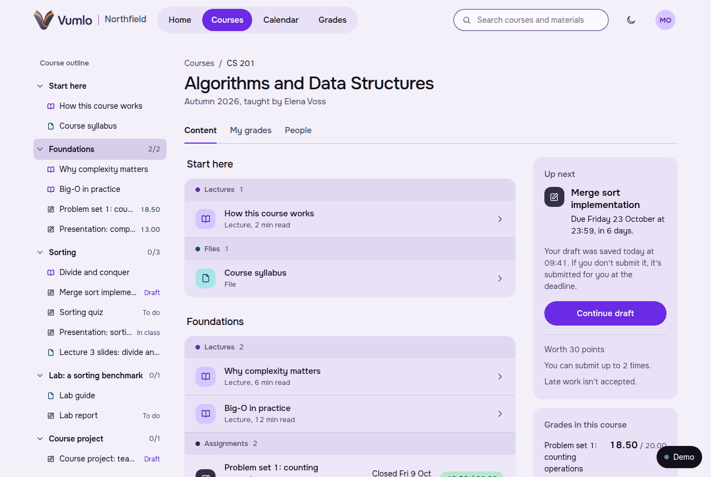
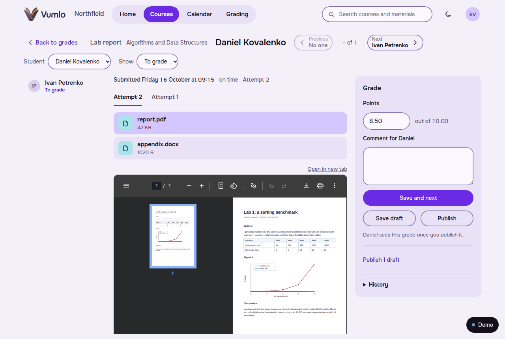
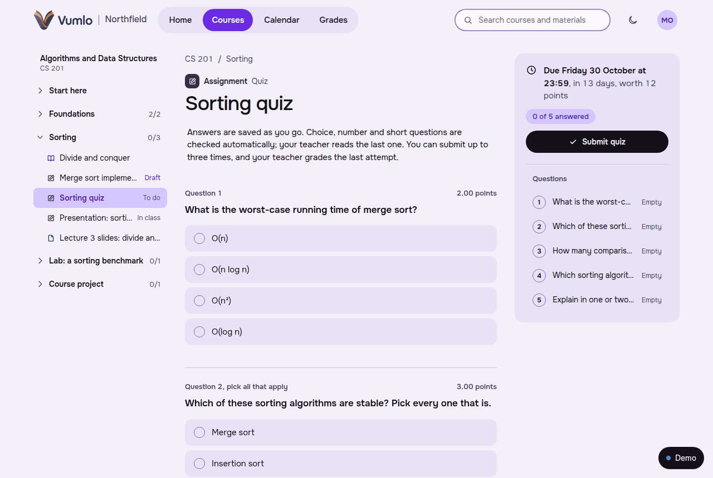
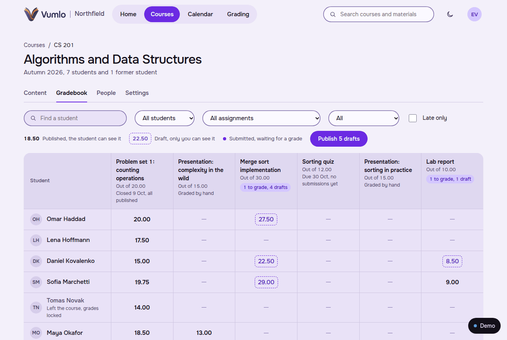
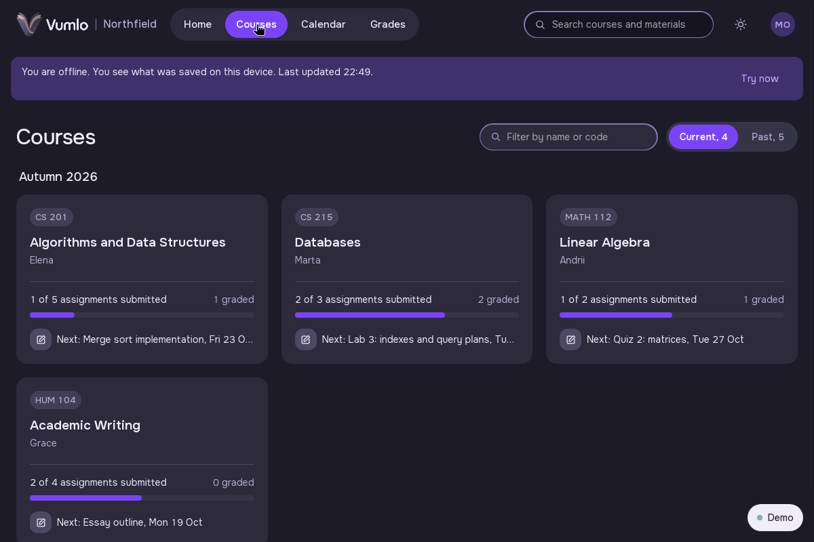

<p align="center"></p>

# Vumlo

**A self-hosted learning platform for one school or university.** Teachers build courses and grade work, students
hand it in and see their grades, administrators run people, groups and the audit log. You install it on your own
server, and your data stays there.

<p align="center">
  
</p>

**[Try it in your browser](https://vumlo-demo.partum55.me)**: pick a student, a teacher or an administrator of a made-up
university. Nothing to sign up for, and what you do stays in your browser. The same page offers the desktop app as a
download (demo data, unsigned installers).

## What it does

**Teachers** build a course from sections. A lecture holds formulas, code, tables, video, images and files; a file
section shares slides or a syllabus; drafts stay hidden until published. Work comes in five kinds: a text answer, a
hand-in of files, a quiz (choice, multiple choice, number, short text and long text questions, checked automatically
where it can be), a form (a team name, a project variant that only one team may take, a link), and work done in class.
Grading has its own page: the student's work next to the grade, a PDF shown in place, previous and next, save as a draft
and publish later. The gradebook shows every student and every assignment.

<p align="center">
  
</p>

**Students** write with drafts that are kept, see deadlines and a calendar, take quizzes whose answers are saved as they
go, hand in files, and read grades and comments once the teacher has published them. Nobody sees a grade early.

**Administrators** keep the people (self-registration with a verified address, or accounts they create), terms, groups
and subgroups that are linked to courses so that a roster follows its group, and an audit log of what changed. Sign-in is
by password or Google.

<table>
  <tr>
    <td></td>
    <td></td>
  </tr>
  <tr>
    <td align="center">A quiz, answers saved as you go</td>
    <td align="center">The gradebook, with drafts the teacher has not published</td>
  </tr>
</table>

**A desktop app** (Windows, macOS, Linux) is built from your own configuration, so it carries your name and talks only
to your server. It reads courses, deadlines and grades without a connection, keeps what a student writes until there is
one, and reminds them before work is due ([docs/desktop.md](docs/desktop.md)).

<p align="center">
  
</p>

**Plugins and modules** extend it without a fork. A plugin is an HTTP service in any language that Vumlo does not trust:
it is told about events (a submission arrived, a grade was published) and may read what its scopes allow and show its own
page in a tab of an assignment. An example is in [examples/hello-plugin](examples/hello-plugin); the design is
[ADR-0066](docs/decisions/0066-modules-and-plugins.md).

## Install

You need a Linux server with Docker and the Compose plugin (2.24 or newer), Node 20 or newer for the installer, and
several GB of RAM (or swap) for the one-time Rust build. For a real installation also a domain name and an SMTP relay for
sign-up and password-reset mail.

```sh
npx create-vumlo
```

It downloads the newest release and checks it against the release's `SHA256SUMS`, asks for the name of your institution,
its address, who may sign up and a few other things, and writes `vumlo.toml` and `.env` with a generated database
password. Then it prints the handful of commands that build and start Vumlo. The guide to what follows, with TLS, mail,
upgrades and backups, is [docs/install.md](docs/install.md). Without Node, or on a plain Linux server without Docker, the
same guide has the manual steps: download the archive from the [releases](https://github.com/Vumlo/vumlo-core/releases),
verify it, unpack it.

To look around an installation before you add real people: `./vumlo seed --demo`.

## How it is built

A Rust API and a background worker on PostgreSQL 18, a Next.js web app, `vumlo-cli` for the administrator (it installs,
configures and checks), and an optional Tauri desktop app. No Redis and no message broker: queues and scheduled jobs live
in PostgreSQL. Files go to a directory on the server or an S3-compatible bucket. One installation serves one institution.
The interface is in English and Ukrainian. The design and the reasons behind it are in
[ARCHITECTURE.md](ARCHITECTURE.md) and [docs/decisions](docs/decisions).

## What is not here yet

Vumlo is before 1.0: a new minor version may change the configuration, the API or the migrations, and every release lists
what you must do in its **Upgrade notes** ([CHANGELOG.md](CHANGELOG.md)). It does one thing well, the teaching loop of
course, work, grade, and leaves out a lot that a large LMS has. There are no discussion forums, peer review, attendance
registers, rubrics, question banks or other quiz question types (matching, for one), no SCORM or H5P content, no sign-in
through LDAP or SAML, no messages between people, no badges or certificates and no mobile app.
A backup covers the whole installation (`vumlo db backup`); a course cannot be exported or imported on its own, and there
is no import from another system. Some of these could be built as plugins; none is promised.

## Development

[docs/development.md](docs/development.md) has the setup, and [AGENTS.md](AGENTS.md) holds the rules for changes. Releases
are described in [RELEASING.md](RELEASING.md).

## Licence

[MIT](LICENSE).
